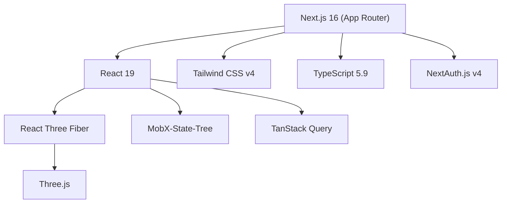

# 1. Обзор проекта

## Что это

**DnD-frontend** — веб-приложение для создания и редактирования 3D-сцен настольных D&D-игр. Позволяет строить воксельные конструкции из кубов, загружать GLTF-модели и управлять камерой/инструментами в интерактивном 3D-редакторе.

## Стек технологий



### Ядро

| Технология | Версия | Назначение                          |
| ---------- | ------ | ----------------------------------- |
| Next.js    | 16     | Фреймворк, App Router, API Routes   |
| React      | 19     | UI-библиотека                       |
| TypeScript | 5.9.3  | Статическая типизация (strict mode) |

### 3D

| Технология        | Версия | Назначение                     |
| ----------------- | ------ | ------------------------------ |
| Three.js          | 0.177  | 3D-движок                      |
| React Three Fiber | 9.1    | React-обёртка над Three.js     |
| @react-three/drei | 10.3   | Готовые 3D-примитивы и хелперы |

### Состояние и данные

| Технология           | Версия | Назначение                             |
| -------------------- | ------ | -------------------------------------- |
| MobX-State-Tree      | 7.0    | Управление состоянием (дерево моделей) |
| TanStack React Query | 5.81   | Кэширование серверных данных           |
| Axios                | 1.11   | HTTP-клиент для загрузки моделей       |

### UI и стили

| Технология     | Версия | Назначение                           |
| -------------- | ------ | ------------------------------------ |
| Tailwind CSS   | 4.2    | Utility-first CSS                    |
| SASS           | 1.97   | Компонентные стили (модули)          |
| CVA            | 0.7    | Variant-based стилизация компонентов |
| @base-ui/react | 1.3    | Unstyled UI-примитивы (от MUI)       |
| Lucide React   | 1.3    | Иконки                               |

### Инфраструктура

| Технология          | Назначение                         |
| ------------------- | ---------------------------------- |
| Turbopack           | Быстрая dev-сборка                 |
| React Compiler      | Автоматическая мемоизация          |
| Critters            | Инлайн критического CSS            |
| Steiger             | FSD-линтинг                        |
| ESLint + boundaries | Контроль зависимостей между слоями |

## Скрипты

```json
{
	"dev": "next dev --turbopack",
	"build": "next build",
	"start": "next start",
	"lint": "eslint .",
	"prettier:check": "npx prettier --check \"./*.{js,jsx,ts,tsx,json,css,scss,md}\"",
	"prettier:write": "npx prettier --write \"./*.{js,jsx,ts,tsx,json,css,scss,md}\"",
	"ui:add": "node scripts/add-ui.ts",
	"fsd": "steiger ./src"
}
```

## Переменные окружения

| Переменная         | Назначение                                                              |
| ------------------ | ----------------------------------------------------------------------- |
| `APP_URL`          | URL бэкенда (по умолч. `http://localhost:1337`, предпол. Strapi CMS)    |
| `YANDEX_CLIENT_ID` | OAuth Client ID Яндекса (задел под авторизацию, в коде не используется) |
| `YANDEX_SECRET_ID` | OAuth Secret Яндекса (задел, в коде не используется)                    |
| `YANDEX_TOKEN`     | OAuth-токен Яндекс Диска — используется API-прокси `/api/models`        |
| `YANDEX_URL`       | Базовый URL API Яндекс Диска для прокси `/api/models`                   |
| `NEXTAUTH_SECRET`  | Секрет NextAuth.js (задел, в коде не используется)                      |

Шаблон — `.env.example`.
