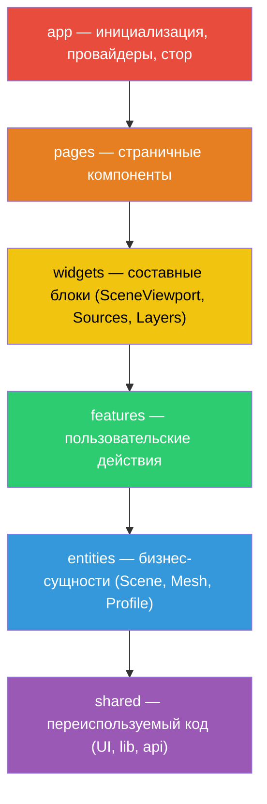

# 2. Feature-Sliced Design (FSD)

## Обзор

Проект следует методологии **Feature-Sliced Design** — архитектурному стандарту для фронтенд-приложений с чёткой иерархией слоёв и правилами импортов.

> [!IMPORTANT]
> FSD строго контролируется через ESLint (`eslint-plugin-boundaries`), правила `no-restricted-imports` и Steiger (`steiger src`).

## Структура слоёв



**Правило:** каждый слой может импортировать **только** из нижележащих слоёв.

## Директории

```
src/
├── app/                      # Слой инициализации (без слайсов)
│   ├── api/
│   │   ├── get-file-yandex-disk.ts  # Прокси файлов с Яндекс Диска (GET /api/models/[...path])
│   │   └── index.ts
│   ├── layouts/
│   │   ├── root-layout.tsx   # RootLayout + metadata: html/body, Providers, Header
│   │   └── index.ts
│   ├── store/
│   │   ├── root-store.ts     # Root, RootStore, начальные данные, module augmentation IStore
│   │   ├── history.ts        # withHistory для construct + обработчик Ctrl+Z / Ctrl+Shift+Z
│   │   └── index.ts
│   ├── styles/
│   │   ├── globals.css       # Tailwind + CSS Custom Properties
│   │   └── _variables.sass   # SASS-переменные
│   └── providers/            # Composition Root
│       ├── providers.tsx     # Обёртка всех провайдеров
│       ├── provider.tsx      # MST DevTools + клавиатурная история
│       ├── store.tsx         # StoreProvider (MST Context)
│       ├── query.tsx         # QueryProvider + SessionProvider
│       └── index.ts
│
├── pages/
│   ├── home/                 # Главная — заглушка
│   └── platform/             # Страница-редактор: Sources | SceneViewport | Layers + Notes
│
├── widgets/
│   ├── scene-viewport/       # 3D-канвас: собирает сущности и фичи сцены
│   │   └── ui/
│   │       ├── scene-viewport.tsx    # Обёртка + слот toolbar
│   │       ├── scene-canvas.tsx      # R3F Canvas, свет, гизмо
│   │       └── scene-models.tsx      # GLTFModel ± TransformControls
│   ├── sources/              # Панель ресурсов (ui/ + model/mock-sources.ts)
│   ├── layers/               # Дерево слоёв (ui/ + model/mock-layers.ts)
│   ├── notes/                # Заметки (Drawer)
│   ├── header/               # Шапка (подключена в src/app/layouts/root-layout.tsx)
│   ├── chat/                 # Заготовка
│   └── properties/           # Заготовка
│
├── features/
│   ├── build-cubes/          # Строительство кубов
│   │   ├── lib/get-cube-position.ts    # getCubePosition — позиция соседнего куба по нормали грани
│   │   └── ui/
│   │       ├── build-grid.tsx          # Сетка + размещение первого куба (публичный)
│   │       ├── buildable-cubes.tsx     # Список кубов (публичный)
│   │       ├── buildable-cube.tsx      # Достраивание / удаление по клику
│   │       ├── cube-placeholder.tsx    # «Призрак» нового куба
│   │       └── cube-side-highlight.tsx # Подсветка грани
│   ├── transform-mesh/       # TransformControls: DragControls / PivotControls
│   ├── select-tool/          # ToolbarScene — выбор инструмента
│   └── upload-model/         # UploadModel — загрузка GLTF (не подключена)
│
├── entities/
│   ├── scene/
│   │   ├── config/default-tools.ts  # createDefaultTools()
│   │   ├── model/
│   │   │   ├── scene.model.ts       # Scene
│   │   │   ├── construct/           # Construct (models, cubes)
│   │   │   ├── editor/              # SceneTools + Tool, CameraControls
│   │   │   ├── hooks.ts             # useStoreScene
│   │   │   └── types.ts
│   │   └── ui/camera.tsx            # Camera (drei CameraControls)
│   ├── mesh/
│   │   ├── @x/scene.ts              # Реэкспорт моделей для entities/scene
│   │   ├── model/                   # MMesh, MModelMesh*, MCubeMesh, MTexture
│   │   └── ui/
│   │       ├── gltf-model.tsx       # GLTFModel — загрузка GLTF и габариты
│   │       └── cube-material.tsx    # CubeMaterial — PBR-текстуры / цвет
│   └── profile/
│       └── model/                   # Profile, useStoreProfile
│
└── shared/                   # Без знания о предметной области
    ├── api/
    │   ├── upload-model.ts   # apiUploadModels (Axios POST)
    │   └── get-model.ts      # fetchGetModel (fetch GET)
    ├── lib/
    │   ├── mst/              # useStore, IStore, withHistory, withMatrix4, MUrlOrCache, zodToMst, useMSTDebug
    │   ├── three/            # matrix4Compose/Decompose, validateTextures, useGltfScaleFromMatrix4
    │   ├── keyboard/         # handlerKeys
    │   └── styles/           # cn()
    └── ui/                   # UI-кит (Base UI + CVA), HiddenSidebar, Tile
```

Правила, по которым код разложен именно так, — в [14. Правила FSD](./14-fsd-rules.md).

## Публичный API (барелы)

Каждый слайс экспортирует свой публичный API через `index.ts`:

```typescript
// entities/scene/index.ts
export * from './config';
export * from './model';
export * from './ui';
```

> [!WARNING]
> Импорт «вглубь» слайса запрещён. Только через `index.ts`:
> ```typescript
> // ✅ Правильно
> import { SceneViewport } from '@/widgets/scene-viewport'
>
> // ❌ Запрещено
> import { SceneViewport } from '@/widgets/scene-viewport/ui/scene-viewport'
> ```

## Кросс-entity паттерн `@x/`

Для импортов между entities (нарушающих правило «entity не импортирует entity») используются специальные `@x/` файлы:

```
entities/mesh/@x/scene.ts   # Реэкспорт для использования в entities/scene
```

Это единственный разрешённый способ кросс-entity зависимостей, контролируемый через ESLint regex-правила.

## Module Augmentation для FSD

Проблема: `shared` слой не может импортировать типы из `app`. Решение — **module augmentation**:

```typescript
// shared/lib/mst/store-context.ts
export interface IStore {}  // Пустой интерфейс

// app/store/root-store.ts
declare module '@/shared/lib/mst/store-context' {
  interface IStore extends Instance<typeof Root> {}
}
```

Это позволяет `shared/lib/mst/hooks.ts` типизировать `useStore()` без импорта из `app`.
