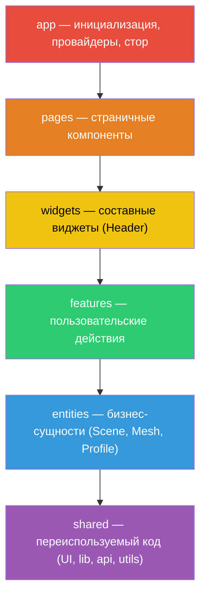

# 2. Feature-Sliced Design (FSD)

## Обзор

Проект следует методологии **Feature-Sliced Design** — архитектурному стандарту для фронтенд-приложений с чёткой иерархией слоёв и правилами импортов.

> [!IMPORTANT]
> FSD строго контролируется через ESLint (`eslint-plugin-boundaries`), правила `no-restricted-imports` и Steiger (`steiger src`).

## Структура слоёв



**Правило:** каждый слой может импортировать **только** из нижележащих слоёв.

## Директории

```
src/
├── app/                      # Слой инициализации
│   ├── store.ts              # Корневой MST-стор + module augmentation
│   ├── styles/               # Глобальные стили + переменные
│   │   ├── globals.css       # Tailwind импорт + CSS Custom Properties
│   │   └── _variables.sass   # DnD-тематические SASS-переменные
│   └── providers/            # Composition Root (провайдеры)
│       ├── providers.tsx     # Обёртка всех провайдеров
│       ├── provider.tsx      # MST debug + keyboard history
│       ├── store.tsx         # StoreProvider (MST Context)
│       └── query.tsx         # QueryProvider + SessionProvider
│
├── pages/                    # Слой страниц
│   └── platform/             # Основная страница-редактор
│       ├── index.ts
│       └── ui/
│           ├── platform.tsx          # Компоновка виджетов
│           └── platform.module.sass  # Layout (flex row)
│
├── widgets/                  # Слой виджетов
│   ├── header/               # Шапка приложения
│   │   ├── index.ts
│   │   └── ui/
│   ├── scene-viewport/       # Обёртка 3D-канваса + тулбар
│   │   ├── index.ts
│   │   ├── api/  config/  model/
│   │   └── ui/
│   │       ├── scene.tsx             # observer — слот для toolbar
│   │       └── scene.module.sass
│   ├── sources/              # Панель ресурсов (текстуры, модели, NPC)
│   │   ├── index.ts
│   │   ├── api/  config/  model/
│   │   └── ui/
│   │       ├── sources.tsx           # Tabs + фильтрация + HiddenSidebar
│   │       └── sources.module.sass
│   ├── layers/               # Дерево слоёв сцены
│   │   ├── index.ts
│   │   ├── api/  config/  model/
│   │   └── ui/
│   │       ├── layers.tsx            # Рекурсивный рендер + Checkbox
│   │       └── layers.module.sass
│   ├── notes/                # Заметки (Drawer)
│   │   ├── index.ts
│   │   ├── api/  config/  model/
│   │   └── ui/
│   │       ├── notes.tsx             # Drawer-компонент
│   │       └── notes.module.sass
│   ├── chat/                 # Чат (заготовка)
│   │   ├── index.ts
│   │   ├── api/  config/  model/
│   │   └── ui/
│   ├── properties/           # Панель свойств (заготовка)
│   │   ├── index.ts
│   │   ├── api/  config/  model/
│   │   └── ui/
│   └── charapter-list/       # Список персонажей (пустая директория)
│
├── features/                 # Слой фич
│   ├── toolbar/              # Панель инструментов 3D-сцены
│   │   ├── index.ts
│   │   └── ui/
│   │       └── toolbar.tsx           # Динамический рендер из MST SceneTools
│   ├── add-mesh/             # Загрузка GLTF-моделей
│   │   ├── index.ts
│   │   └── ui/
│   │       └── add-mesh.tsx          # FileInput + Axios upload
│   └── sidebar/              # Боковая панель (заготовка)
│       ├── index.ts
│       ├── api/  model/
│       └── ui/
│
├── entities/                 # Слой бизнес-сущностей
│   ├── profile/              # Профиль пользователя
│   │   ├── index.ts
│   │   ├── model/
│   │   │   └── profile.model.ts     # MST-модель + setProfile(session)
│   │   └── ui/               # UI профиля (пусто)
│   ├── scene/                # 3D-сцена
│   │   ├── index.ts
│   │   ├── model/
│   │   │   ├── scene.model.ts       # Scene (isViewGrid, isEditable, selectedMeshIds)
│   │   │   ├── construct/
│   │   │   │   └── construct.model.ts  # Construct (models Map, cubes Map)
│   │   │   ├── editor/
│   │   │   │   ├── scene-tools.model.ts  # SceneTools + Tool (id, group, iconURL...)
│   │   │   │   └── camera-controls.model.ts
│   │   │   └── types.ts
│   │   └── ui/               # 3D-компоненты (Canvas, Grid, Cubes, Models)
│   │       ├── scene-canvas.tsx
│   │       ├── interactive-grid.tsx
│   │       ├── building-cube.tsx
│   │       ├── building-cube-side.tsx
│   │       ├── building-cube-texture.tsx
│   │       ├── builded-cubes.tsx
│   │       ├── builded-cube-transparent.tsx
│   │       ├── gltf-model.tsx
│   │       ├── gltf-models.tsx
│   │       ├── camera.tsx
│   │       └── controls.tsx
│   └── mesh/                 # Меш-модели (куб, GLTF)
│       ├── index.ts
│       ├── @x/               # Кросс-entity реэкспорты
│       │   └── scene.ts
│       ├── api/
│       └── model/
│           ├── mesh.ts              # MMesh (id)
│           ├── model-mesh.ts        # MModelMesh, MModelInternalMesh, MModelExternalMesh
│           └── cube-mesh.ts         # MCubeMesh (+ withMatrix4)
│
└── shared/                   # Общий переиспользуемый код
    ├── api/                  # HTTP-клиенты
    │   ├── api.ts            # apiUploadModels (Axios POST)
    │   └── get-model.ts      # fetchGetModel (fetch GET)
    ├── lib/                  # Утилитарные библиотеки
    │   ├── mst/              # MST-хелперы и хуки
    │   │   ├── hooks.ts          # useStore, useStoreScene, useStoreProfile
    │   │   ├── store-context.ts  # StoreContext + IStore (module augmentation)
    │   │   ├── with-history.ts   # Undo/Redo через JSON Patches
    │   │   ├── with-placement.ts # withMatrix4 миксин (4×4 трансформации)
    │   │   ├── texture.model.ts  # MTexture — набор PBR-карт
    │   │   ├── cache.ts          # MUrlOrCache (url + cacheUrl)
    │   │   ├── recurse-children.ts
    │   │   └── zot-to-mst.ts     # zodToMst() — конвертер Zod → MST
    │   ├── three/            # Three.js утилиты
    │   │   ├── get-cube-position-based-side.ts
    │   │   ├── get-placement-from-matrix4.ts
    │   │   ├── matrix4-compose.ts
    │   │   ├── matrix4-decompose.ts
    │   │   ├── validate-textures.ts
    │   │   └── hooks.ts          # useGltfScaleFromMatrix4
    │   ├── styles/           # cn() утилита
    │   └── debug/            # MST DevTools (connectReduxDevtools)
    ├── ui/                   # UI-компоненты (Base UI + CVA)
    │   ├── button/           ├── avatar/
    │   ├── input/            ├── checkbox/
    │   ├── select/           ├── tabs/
    │   ├── toggle/           ├── toggle-group/
    │   ├── toolbar/          ├── tooltip/
    │   ├── drawer/           ├── dropdown-menu/
    │   ├── scroll-area/      ├── collapsible/
    │   ├── autocomplete/     ├── tile/
    │   └── hidden-sidebar/   # HiddenSidebar — сворачиваемая боковая панель
    └── utils/                # Общие утилиты
        ├── handler-keys.ts   # Обработчик горячих клавиш
        └── mapping.ts        # ArrayWithObjectToMap, MapToArray, MSTMapToArray
```

## Публичный API (барелы)

Каждый слайс экспортирует свой публичный API через `index.ts`:

```typescript
// entities/scene/index.ts
export * from './model'
export * from './ui'
```

> [!WARNING]
> Импорт «вглубь» слайса запрещён. Только через `index.ts`:
> ```typescript
> // ✅ Правильно
> import { SceneCanvas } from '@/entities/scene'
> 
> // ❌ Запрещено
> import { SceneCanvas } from '@/entities/scene/ui/scene-canvas'
> ```

## Кросс-entity паттерн `@x/`

Для импортов между entities (нарушающих правило «entity не импортирует entity») используются специальные `@x/` файлы:

```
entities/mesh/@x/scene.ts   # Реэкспорт для использования в entities/scene
```

Это единственный разрешённый способ кросс-entity зависимостей, контролируемый через ESLint regex-правила.

## Module Augmentation для FSD

Проблема: `shared` слой не может импортировать типы из `app`. Решение — **module augmentation**:

```typescript
// shared/lib/mst/store-context.ts
export interface IStore {}  // Пустой интерфейс

// app/store.ts
declare module '@/shared/lib/mst/store-context' {
  interface IStore extends Instance<typeof Root> {}
}
```

Это позволяет `shared/lib/mst/hooks.ts` типизировать `useStore()` без импорта из `app`.
