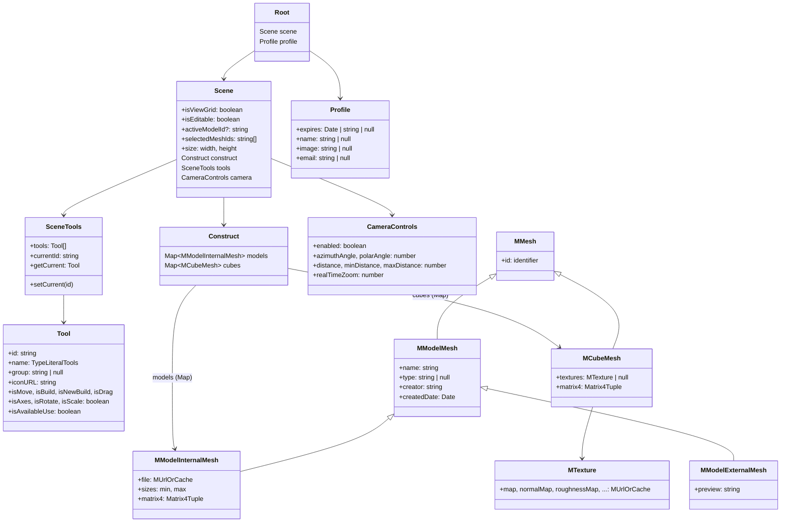
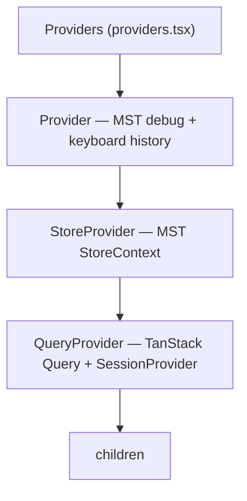

# 3. Управление состоянием — MobX-State-Tree

## Обзор

Клиентское состояние управляется через **MobX-State-Tree (MST)** — типизированное реактивное дерево состояния с поддержкой снапшотов, патчей и middleware.

## Иерархия моделей



## Composition Root (Провайдеры)



Порядок вложенности важен:
1. **Provider** — подключает MST DevTools и обработчик горячих клавиш для undo/redo
2. **StoreProvider** — создаёт MST-стор и передаёт через React Context
3. **QueryProvider** — оборачивает в TanStack `QueryClientProvider` и NextAuth `SessionProvider`

## Хуки доступа к стору

```typescript
useStore()         // → экземпляр Root (RootStore)
useStoreScene()    // → store.scene
useStoreProfile()  // → store.profile
```

`useStore` лежит в `shared/lib/mst/hooks.ts` и читает `React.useContext(StoreContext)`. Хуки частей стора принадлежат сущностям: `useStoreScene` — `entities/scene/model/hooks.ts`, `useStoreProfile` — `entities/profile/model/hooks.ts`.

## Миксины (Composable Models)

### `withHistory()` — Undo/Redo

Добавляет undo/redo через JSON-патчи MST:

```typescript
// src/app/store/history.ts — история подключена к construct (кубы и модели)
const StoreSceneHistory = withHistory(RootStore.scene.construct, [
  '/sizes/min', // Исключить из истории
  '/sizes/max',
])
```

- Использует `onPatch()` для записи и `applyPatch()` для воспроизведения
- Подключена только к `scene.construct` — выбор инструмента, выделение и камера в историю не попадают
- Поддерживает исключение путей (`/sizes/min`, `/sizes/max` — размеры bounding box, вычисляемые при загрузке GLTF)
- Горячие клавиши: `Ctrl+Z` (undo), `Ctrl+Shift+Z` (redo); обработчик висит на `keyup`

### `withMatrix4()` — 3D-трансформации

Добавляет к модели 4×4 матрицу трансформации:

```typescript
const PositionedMesh = withMatrix4(MMesh)
```

- Хранит `matrix4` как `t.frozen<Matrix4Tuple>()` (16 чисел, по умолчанию единичная матрица) — позиция, поворот, масштаб
- Views: `getMatrix4`, `getMatrixArray`, `getPlacement` (разложение на position/rotation/scale); actions: `setMatrix4`, `setMatrix4FromPlacement`
- Утилиты `matrix4Compose` / `matrix4Decompose` для работы с Three.js `Matrix4`
- Используется в `MCubeMesh` и `MModelInternalMesh`

### `MUrlOrCache` — URL с кэшированием

```typescript
MUrlOrCache = {
  url: string,
  cacheUrl: string | null,  // альтернативный источник (например, data/blob URL)
}
// view getSource → cacheUrl, если задан, иначе url
```

## Реактивность в 3D-компонентах

Все компоненты, читающие MST-состояние, обёрнуты в `observer()` из `mobx-react-lite`:

```typescript
export const BuildableCube = observer(({ id }: Props) => {
  const cube = useStoreScene().construct.cubes.get(id)
  // Перерендерится ТОЛЬКО при изменении данных этого конкретного куба
})
```

> [!TIP]
> `observer()` обеспечивает **гранулярную реактивность** — в 3D-сцене с сотнями кубов перерисовывается только изменённый компонент, а не вся сцена.

## DevTools

В development-режиме MST подключается к **Redux DevTools Extension** через `mst-middlewares`:

```typescript
// shared/lib/debug/use-mst-debug.ts — только при NODE_ENV === 'development'
const extension = window.__REDUX_DEVTOOLS_EXTENSION__
const remoteDevMock = {
  connectViaExtension: (conf) => extension.connect(conf),
  extractState: (obj) => obj,
}
connectReduxDevtools(remoteDevMock, store)
```

Это позволяет инспектировать дерево состояния, историю действий и патчи в браузерном расширении.
