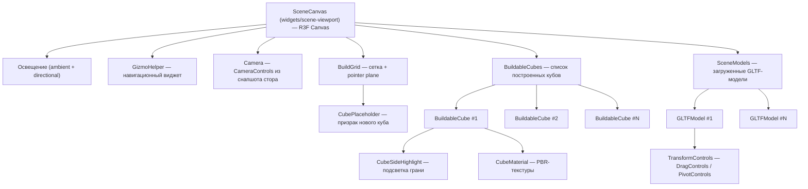

# 4. 3D-движок и сцена

## Стек

| Библиотека | Назначение |
|---|---|
| **Three.js** | Низкоуровневый 3D-движок (WebGL) |
| **React Three Fiber (R3F)** | Декларативная React-обёртка над Three.js |
| **@react-three/drei** | Готовые хелперы: `useTexture`, `GizmoHelper`, `DragControls`, `PivotControls` |
| **AnimeJS** | Установлен, в коде пока не используется |
| **Leva** | Debug-панели для 3D (devDependency), в коде пока не используется |

## Архитектура сцены



## Компоненты

| Компонент | Слайс |
|---|---|
| `SceneViewport`, `SceneCanvas`, `SceneModels` | `widgets/scene-viewport` |
| `BuildGrid`, `BuildableCubes`, `BuildableCube`, `CubePlaceholder`, `CubeSideHighlight` | `features/build-cubes` |
| `TransformControls` | `features/transform-mesh` |
| `ToolbarScene` | `features/select-tool` |
| `GLTFModel`, `CubeMaterial` | `entities/mesh` |
| `Camera` | `entities/scene` |

### SceneCanvas

Корневой `<Canvas>` из R3F. Настраивает:
- Ambient + Directional освещение
- `GizmoHelper` (навигационный куб в углу)
- Вложенные 3D-компоненты

### BuildGrid

- Визуальная сетка `Grid` из drei размером `scene.size` (по умолчанию 20×20); скрывается при `isViewGrid = false`
- Невидимый `mesh` с `PlaneGeometry` (opacity 0) ловит `pointermove` — точка пересечения округляется до клетки, и в ней рисуется `CubePlaceholder`
- Работает только при инструменте с флагом `isNewBuild`

### BuildableCube

Воксельный куб сцены:
- Все обработчики активны только при флаге `isBuild` текущего инструмента
- **Наведение на грань** → `getCubePosition(e.normal, position)` (`features/build-cubes/lib`) вычисляет позицию соседнего куба
- **Левый клик** → `construct.addCell(position)`
- **Правый клик** (`onContextMenu`) → `construct.removeCell(id)`
- **Hover** → подсветка грани (`CubeSideHighlight`)
- **PBR-текстуры** → загружаются через `CubeMaterial`: `validateTextures` отфильтровывает пустые карты, затем `useTexture` (drei)

### CubePlaceholder

Полупрозрачный «призрак» — предпросмотр позиции нового куба на сетке. Рендерится внутри `BuildGrid`; клик по нему вызывает `construct.addCell(cellPosition)`.

### GLTFModel

- Загружает модель через `useGLTF(model.file.getSource)`
- Вычисляет bounding box (`Box3.setFromObject`) и сохраняет его в `model.setSizes({ min, max })` — используется как `offset` для `PivotControls`
- Сам не знает об интерактиве: виджет `SceneModels` оборачивает его в `TransformControls` (фича `transform-mesh`) при `scene.isEditable`
- Хук `useGltfScaleFromMatrix4` (`shared/lib/three/hooks.ts`) определён, но пока нигде не используется

### TransformControls

Обёртка над инструментами манипуляции модели:
- `isDrag` → `DragControls` — свободное перемещение (порог 5px)
- иначе → `PivotControls`: оси/вращение/масштаб включаются флагами `isAxes`/`isRotate`/`isScale`; гизмо активно только у выделенной модели
- Клик по модели → выделение (`addSelectedByMesh`), клик мимо (`onPointerMissed`) → снятие выделения
- Во время жеста матрица хранится в `useState`, в стор пишется один раз в `onDragEnd`

### Camera

- `CameraControls` из drei; снапшот `scene.camera` передаётся пропсами (`enabled`, углы, `distance`, `min/maxDistance`)
- `enabled = false` во время манипуляции моделью (`scene.setActiveModelId`) — чтобы жест не вращал камеру
- В `onRest` текущая дистанция пишется в `camera.realTimeZoom` (через `setRealTimeDistance`)

## Система инструментов

Управляется через модель `SceneTools` в MST: массив `Tool` + `currentId`. Каждый `Tool` — набор булевых флагов (`isMove`, `isBuild`, `isNewBuild`, `isDrag`, `isAxes`, `isRotate`, `isScale`), компоненты читают флаги из `tools.getCurrent`. Начальный набор создаёт `createDefaultTools()` из `entities/scene/config/default-tools.ts`:

| Инструмент | Описание |
|---|---|
| `move` | Перемещение камеры (`isMove`) |
| `build` | Строительство кубов: достройка к граням и установка на сетку (`isBuild` + `isNewBuild`) |
| `drag` | Перетаскивание моделей |
| `axes` | Перемещение по осям |
| `rotate` | Поворот модели |
| `scale` | Масштабирование модели |
| `transform` | Комбинированная трансформация (`isAxes` + `isRotate` + `isScale`) |

Литерал `newBuild` есть в `TypeLiteralTools`, но отдельного инструмента для него нет.

## Статическая геометрия

> [!TIP]
> Геометрии и материалы Three.js создаются **один раз** вне React-компонентов для экономии памяти:
> ```typescript
> const geometry = new BoxGeometry(1, 1)       // Создаётся 1 раз
> const planeGeo = new PlaneGeometry(0.9, 0.9) // Переиспользуется всеми кубами
> ```
> При сотнях кубов это критично — иначе каждый куб создавал бы свою копию геометрии.
>
> Исключение — `BuildGrid`: `PlaneGeometry` и `MeshBasicMaterial` создаются прямо в JSX на каждом рендере.

## Обработка текстур

`MTexture` описывает все карты `MeshStandardMaterial`, каждая — опциональный `MUrlOrCache`:
`map`, `normalMap`, `roughnessMap`, `metalnessMap`, `aoMap`, `lightMap`, `emissiveMap`, `bumpMap`, `displacementMap`, `alphaMap`, `envMap`.
View `getTextureMap` собирает из них объект `{ имяКарты: url }`.

Текстуры загружаются через `useTexture` (drei) по `MUrlOrCache.getSource` (`cacheUrl`, если задан, иначе `url`).

## API загрузки моделей

```
POST /api/models?folder={name}  → загрузка (Axios, тело — Uint8Array файла)  ⚠️ обработчика нет
GET  /api/models/{path}         → файл модели/текстуры (прокси к Яндекс Диску)
```

Реализован только `GET` в `app/api/models/[...path]/route.ts` (логика — `src/app/api/get-file-yandex-disk.ts`) — подробнее в [Роутинге и компоновке](./10-routing-and-layout.md). Клиентские функции `apiUploadModels` и `fetchGetModel` (`shared/api`) объявлены; `fetchGetModel` пока нигде не вызывается, модели в сцене грузятся напрямую через `useGLTF`.
