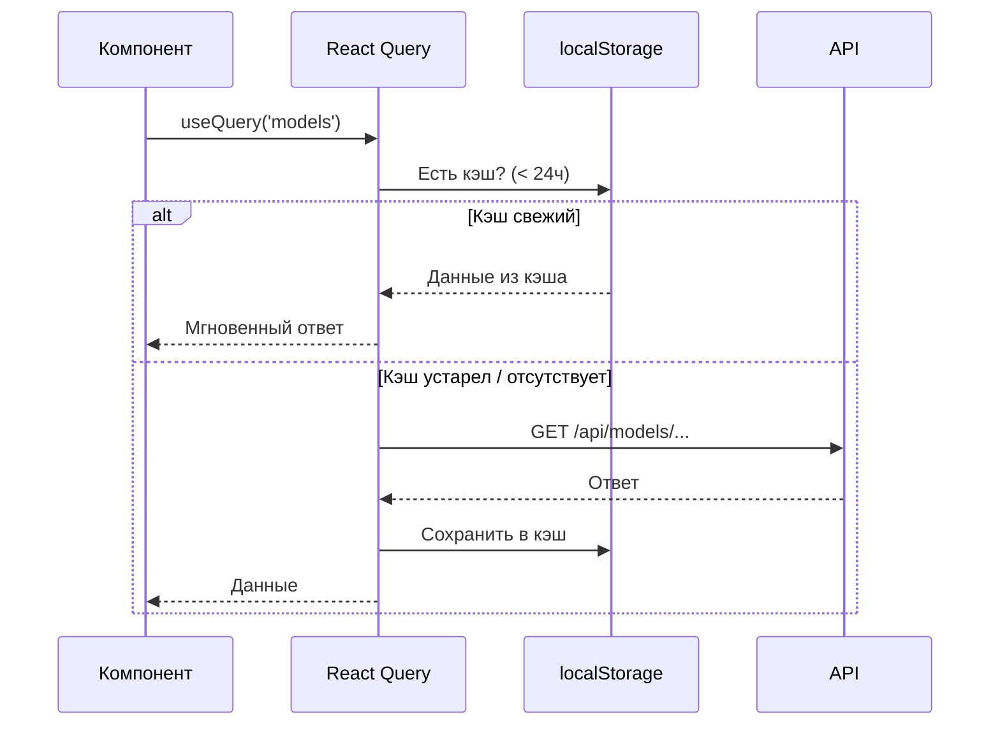
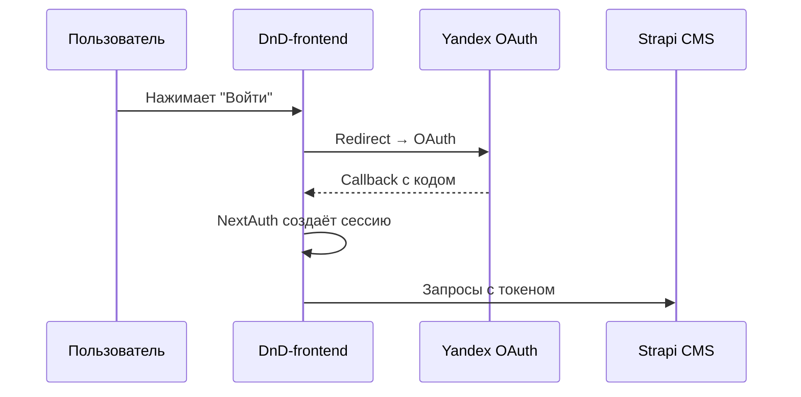

# 6. Сетевой слой и аутентификация

## Получение данных — TanStack React Query

### Конфигурация

```typescript
// Persistence: localStorage с 24-часовым TTL
const queryClient = new QueryClient({
  defaultOptions: {
    queries: {
      gcTime: 1000 * 60 * 60 * 24,  // 24 часа
    }
  }
})

// Персистенция подключается в useEffect (только на клиенте):
persistQueryClient({
  queryClient,
  persister: createSyncStoragePersister({ storage: window.localStorage }),
  maxAge: 1000 * 60 * 60 * 24,
})
```

> [!NOTE]
> Инфраструктура настроена, но `useQuery`/`useMutation` в коде пока не вызываются — схема ниже описывает целевое поведение.



> [!NOTE]
> Зависимость `mst-query@^4.4.1` присутствует в проекте, но пока не используется. Вероятно, планируется интеграция React Query непосредственно с MST-моделями.

## HTTP-клиенты

### Axios — загрузка моделей

```typescript
// shared/api/upload-model.ts
POST /api/models?folder={name}  // FormData с .gltf + текстурами
```

### Fetch — получение моделей

```typescript
// shared/api/get-model.ts
GET /api/models/{name}.gltf   // GLTF-модель
GET /api/models/{name}.png    // Текстура
```

### API Routes (Next.js)

Серверный обработчик `getFileYandexDisk` (`src/app/api`, подключён в `app/api/models/[...path]/route.ts`, только `GET`) проксирует файлы с Яндекс Диска, подставляя `YANDEX_TOKEN` на сервере. Обработчика `POST` для загрузки пока нет — подробнее в [Роутинге и компоновке](./10-routing-and-layout.md#api-роут-apimodelspath).

## Аутентификация — NextAuth.js v4

> [!WARNING]
> **Авторизация пока не реализована.** В проекте нет роута `app/api/auth/[...nextauth]`, конфигурации NextAuth и провайдера Яндекса. Есть только зависимость `next-auth`, `SessionProvider` в провайдерах, MST-модель `Profile` и переменные `YANDEX_CLIENT_ID` / `YANDEX_SECRET_ID` / `NEXTAUTH_SECRET` в `.env.example`. Ниже — целевая схема.

### Провайдер (план)

**Yandex OAuth** — планируемый провайдер:



### Конфигурация

| Параметр | Значение |
|---|---|
| Провайдер | Yandex OAuth (план) |
| JWT | `jose@^6.0.11` — установлен, в коде не используется |
| Сессия | `SessionProvider` (next-auth/react) с сессией, собранной из MST `Profile` |
| Секрет | `NEXTAUTH_SECRET` (env) |

### Интеграция с MST

```typescript
// entities/profile/model/profile.model.ts
Profile = t.model('Profile', {
  expires: t.maybeNull(t.union(t.Date, t.string)),
  name: t.maybeNull(t.string),
  image: t.maybeNull(t.string),
  email: t.maybeNull(t.string),
}).actions((self) => ({
  setProfile(session: SessionContextValue) { /* копирует expires и user */ },
}))
```

Сейчас данные текут **из MST в NextAuth**, а не наоборот: `QueryProvider` читает `useStoreProfile()` и собирает из него объект `session` для `SessionProvider` (`null`, если `expires === null`). Action `setProfile` объявлен, но нигде не вызывается — профиль всегда пустой.

### Цепочка провайдеров

```
Providers → Provider (MST debug) → StoreProvider (MST) → QueryProvider (React Query + SessionProvider)
```

`SessionProvider` рендерится внутри `QueryProvider`, а сам `QueryProvider` вызывает `useStoreProfile()` — поэтому он обязан стоять ниже `StoreProvider`.

## Бэкенд

| Параметр | Значение |
|---|---|
| URL | `http://localhost:1337` (env `APP_URL`) — переменная объявлена, в коде не используется |
| Предположительно | **Strapi CMS** (стандартный порт Strapi) |
| Назначение | Хранение моделей, профилей, данных сцен (план) |

Единственный реально используемый внешний источник сейчас — Яндекс Диск через прокси `/api/models/[...path]`.
