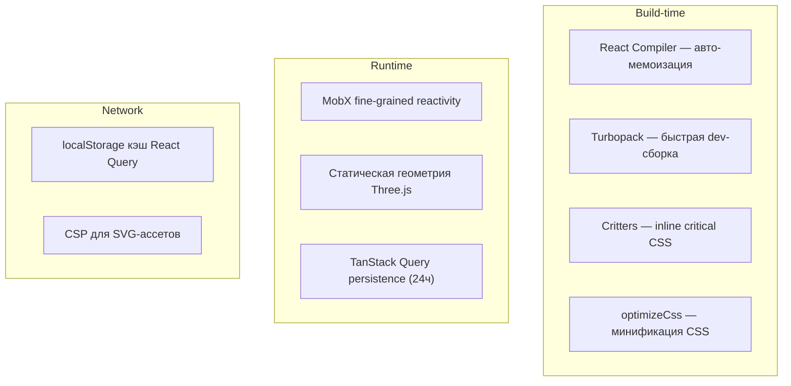

# 7. Производительность и оптимизации

## Обзор

Проект использует многоуровневую стратегию оптимизации — от сборки до рантайма:



## 1. React Compiler

```typescript
// next.config.ts
reactCompiler: true  // в Next.js 16 — опция верхнего уровня
```

**Что делает:** Автоматически добавляет `useMemo`, `useCallback` и мемоизацию в компоненты без ручного написания. Устраняет целый класс проблем с лишними ре-рендерами.

> [!IMPORTANT]
> Требует `babel-plugin-react-compiler` (devDependency, v1.0). Компилятор работает через Babel, поэтому сборка файлов с ним медленнее, чем чистым SWC.

## 2. Turbopack

```bash
next dev --turbopack
```

Замена Webpack на Rust-based сборщик для dev-режима. Ускоряет:
- Холодный старт
- Hot Module Replacement (HMR)
- Инкрементальную пересборку

## 3. Оптимизация CSS

| Инструмент | Назначение |
|---|---|
| **Critters** (`critters@^0.0.25`) | Инлайнит критический CSS в `<head>` для быстрого First Paint |
| **`experimental.optimizeCss`** | Минификация и дедупликация CSS в production |
| **PostCSS pipeline** | `@tailwindcss/postcss` → `flexbugs-fixes` → `postcss-preset-env` (с autoprefixer) |

## 4. MobX Fine-Grained Reactivity

Каждый `observer()` компонент **подписывается только на прочитанные observable**:

```typescript
// Перерендерится ТОЛЬКО при изменении cube.matrix4 или cube.textures
const BuildingCube = observer(({ id }) => {
  const cube = store.construct.cubes.get(id)
  return <mesh matrix={cube.matrix4}>
    <Texture maps={cube.textures} />
  </mesh>
})
```

В 3D-сцене с сотнями объектов это критично — изменение одного куба не вызывает перерендер всех остальных.

## 5. Статическая геометрия Three.js

```typescript
// Создаётся ОДИН РАЗ за пределами компонента
const boxGeometry = new BoxGeometry(1, 1)
const planeGeometry = new PlaneGeometry(0.9, 0.9)

// Переиспользуется всеми экземплярами
const BuildingCube = observer(() => (
  <mesh geometry={boxGeometry}>...</mesh>
))
```

> [!TIP]
> Без этой оптимизации каждый из N кубов создавал бы свою копию `BoxGeometry` — O(N) аллокаций GPU-буферов вместо O(1).
>
> Нарушение: `InteractiveGrid` создаёт `PlaneGeometry` и `MeshBasicMaterial` в JSX на каждом рендере — их стоит вынести в `useMemo` по `scene.size`.

## 6. Кэширование данных

### TanStack Query Persistence

- **Время жизни кэша:** 24 часа (`gcTime`)
- **Хранилище:** `localStorage` через `query-sync-storage-persister`
- **Эффект:** При перезагрузке страницы данные отображаются мгновенно из кэша, обновляясь в фоне
- **Статус:** запросов через React Query пока нет, поэтому кэш фактически пуст

### MUrlOrCache

Любой файл (текстура, GLTF) может иметь альтернативный источник прямо в MST-сторе:

```typescript
MUrlOrCache = {
  url: 'https://...',         // Основной источник
  cacheUrl: 'data:image/...'  // Приоритетный, если задан
}
// getSource → cacheUrl ?? url
```

## 7. SVG-безопасность

```typescript
// next.config.ts
images: {
  dangerouslyAllowSVG: true,
  contentDispositionType: 'attachment',
  contentSecurityPolicy: "default-src 'self'; script-src 'none'; sandbox;"
}
```

SVG разрешены, но с CSP-политикой, предотвращающей XSS через SVG-файлы.

## Что можно добавить

| Оптимизация | Статус |
|---|---|
| ✅ React Compiler | Включён |
| ✅ Turbopack | Включён |
| ✅ Critical CSS | Включён |
| ✅ MobX granular updates | Используется |
| ✅ Static geometry | Используется |
| ✅ Query persistence | Настроено |
| ⬜ Three.js instancing | Не используется (потенциал для кубов) |
| ⬜ Web Workers | Не используются (потенциал для расчётов) |
| ⬜ Dynamic imports | Не замечены (`React.lazy` / `next/dynamic`) |
| ⬜ Image optimization | `next/image` не замечен для текстур |
