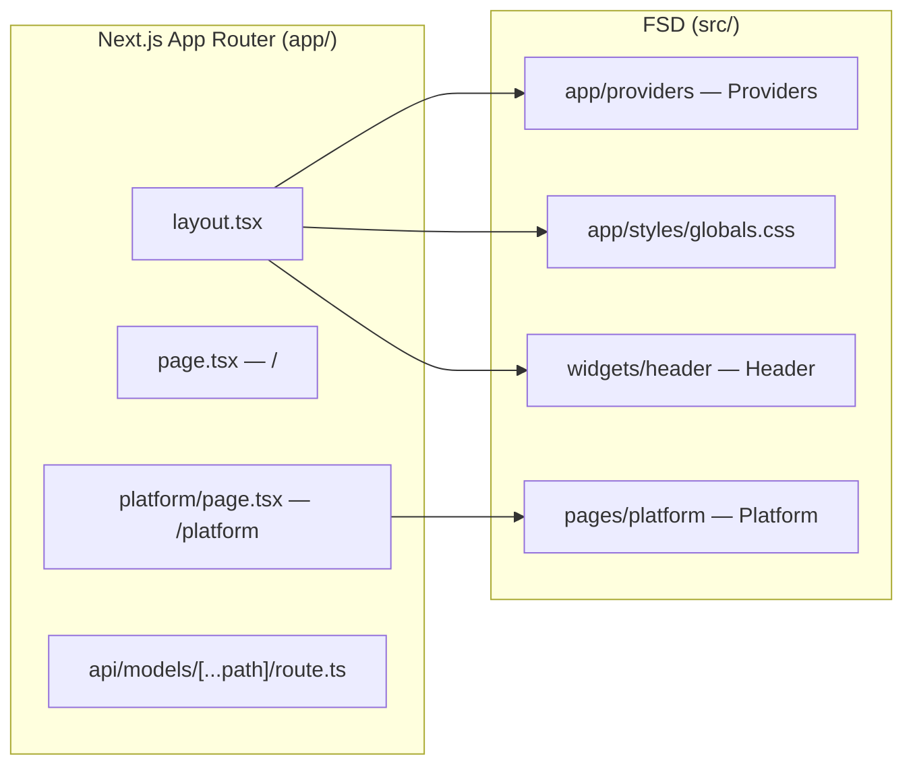
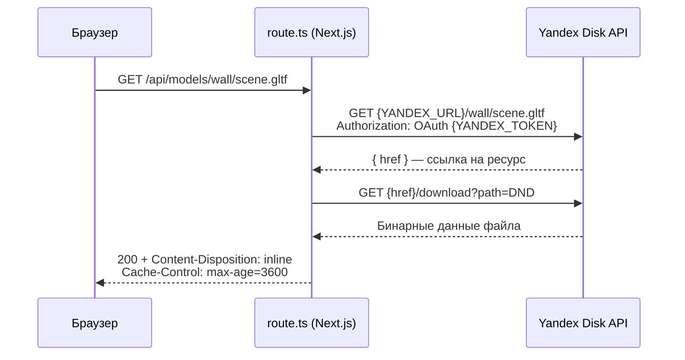

# 10. Роутинг и компоновка страниц

## Два «app» в проекте

В репозитории есть **две разные директории `app`**, и их легко перепутать:

| Директория | Что это | Что лежит |
|---|---|---|
| `app/` (корень) | **Next.js App Router** — файловый роутинг | `layout.tsx`, `page.tsx`, роуты страниц и API |
| `src/app/` | **FSD-слой `app`** — инициализация приложения | Корневой MST-стор, провайдеры, глобальные стили |

Роутер Next.js остаётся «тонким»: файлы в `app/` только импортируют страницы из FSD-слоя `pages` и ничего не знают о бизнес-логике.



> [!NOTE]
> Слой `pages` FSD и Pages Router Next.js называются одинаково, но не связаны. Next.js игнорирует `src/app` и `src/pages`, если в корне есть `app/` или `pages/`. Поэтому в корне лежит пустая директория `pages/` (только `README.md`) — стандартный приём FSD для Next.js: она гарантирует, что `src/pages/` никогда не будет воспринят как Pages Router.

## Роуты

| Путь | Файл | Назначение |
|---|---|---|
| `/` | `app/page.tsx` | Заглушка (пустой фрагмент), под будущий лендинг/список сцен |
| `/platform` | `app/platform/page.tsx` | Редактор сцены — рендерит `<Platform />` |
| `GET /api/models/[...path]` | `app/api/models/[...path]/route.ts` | Прокси файлов с Яндекс Диска |

### RootLayout

`app/layout.tsx` — общий каркас для всех страниц:

```tsx
<html lang="ru" data-theme="dark">
  <body>
    <div className="root" style={{ display: 'contents' }}>
      <Providers>        {/* MST + React Query + NextAuth */}
        <Header />       {/* widgets/header */}
        <main>{children}</main>
      </Providers>
    </div>
  </body>
</html>
```

- `data-theme="dark"` выставлен жёстко — тёмная тема по умолчанию (см. [Стилизация](./05-styling.md)).
- `Header` рендерится вне страниц, поэтому виден на всех роутах.
- Все провайдеры подключаются один раз здесь — страницы получают стор через хуки (`useStore`, `useStoreScene`).

### API-роут `/api/models/[...path]`

Catch-all обработчик проксирует файлы моделей и текстур с **Яндекс Диска**, скрывая OAuth-токен от клиента:



- Токен `YANDEX_TOKEN` используется только на сервере.
- Ответ кэшируется браузером на 1 час (`Cache-Control: public, max-age=3600`).
- При любой ошибке возвращается `500` с JSON `{ error }`.

> [!WARNING]
> Обработчика `POST` в роуте нет, хотя `shared/api/upload-model.ts` (`apiUploadModels`) и фича `upload-model` отправляют `POST /api/models?folder=...`. Загрузка моделей сейчас не работает end-to-end.

## Страница Platform

`pages/platform` — единственная полноценная страница. Она **только компонует** виджеты и фичи, собственной логики у неё нет:

```tsx
// src/pages/platform/ui/platform.tsx
export function Platform() {
  return (
    <div className={styles.page}>
      <Sources />                              {/* левая панель */}
      <SceneViewport toolbar={<ToolbarScene />} /> {/* центр: 3D-канвас */}
      <Layers />                               {/* правая панель */}
      <Notes />                                {/* выезжающий Drawer */}
    </div>
  )
}
```

### Раскладка

```
┌──────────────────────────────────────────────────────────────────┐
│ Header                                                           │
├────────────┬──────────────────────────────────────┬──────────────┤
│ Sources    │ SceneViewport                        │ Layers       │
│ (324px)    │ ┌──────────────────────────────────┐ │ (256px)      │
│ ┌────────┐ │ │ ToolbarScene                     │ │ ☑ Layer 1    │
│ │Search  │ │ └──────────────────────────────────┘ │   ☑ Sub 1    │
│ ├────────┤ │                                      │   ☐ Sub 2    │
│ │Tabs    │ │         SceneCanvas (R3F)            │ ☐ Layer 2    │
│ ├────────┤ │                                      │              │
│ │Tiles   │ │                                      │              │
│ └────────┘ │                                      │              │
├────────────┴──────────────────────────────────────┴──────────────┤
│                         [Заметки] → Drawer                       │
└──────────────────────────────────────────────────────────────────┘
```

- Контейнер `.page` — `flex-direction: row`, `gap: 4px`, `padding: 4px`, занимает всю высоту.
- Боковые панели — `HiddenSidebar` (см. [UI-кит](./11-ui-kit.md)): сворачиваются отрицательным `margin` на свою ширину, и сцена автоматически растягивается за счёт flex.
- `Notes` — Base UI `Drawer`, рендерится через портал поверх страницы и не занимает место во flex-ряду.

### Паттерн «слот» в виджете SceneViewport

Виджет `SceneViewport` не импортирует тулбар напрямую — он принимает его через проп `toolbar?: ReactNode`:

```tsx
// widgets/scene-viewport/ui/scene-viewport.tsx
export const SceneViewport = observer(function SceneViewport({ toolbar }: IProps) {
  const { isMove } = useStoreScene().tools.getCurrent
  return (
    <div className={`${styles.scene} ${isMove ? styles.scene__is_move : ''}`}>
      {toolbar && <div className={styles.scene__tools}>{toolbar}</div>}
      <SceneCanvas />
    </div>
  )
})
```

**Зачем:** виджет и фича оказываются независимыми, а связывает их страница — верхний слой. Это стандартный FSD-приём для композиции: `widgets` не тянут конкретные `features`, если те могут быть заменены (например, другой тулбар для режима просмотра).

## Статус виджетов

| Виджет / фича | Слой | Состояние | Источник данных |
|---|---|---|---|
| `Header` | widgets | Пустой `<header>` | — |
| `SceneViewport` | widgets | ✅ Работает | MST `scene` |
| `ToolbarScene` | features | ✅ Работает | MST `scene.tools` |
| `Sources` | widgets | 🟡 UI готов | Мок `MOCK_SOURCES` (`model/mock-sources.ts`) |
| `Layers` | widgets | 🟡 UI готов | Мок `MOCK_LAYERS` (`model/mock-layers.ts`) |
| `Notes` | widgets | 🟡 Каркас Drawer | Текст-заглушка |
| `UploadModel` | features | 🟡 Не подключена к странице | Axios `POST` (роута нет) |
| `Chat`, `Properties` | widgets | ⬜ Заглушки | — |

## Известные отклонения от правил

- `Sources` и `Layers` берут данные из моков в своём `model`-сегменте. При подключении реальных данных они должны переехать в MST (`entities`) или React Query (`api`-сегмент слайса).
