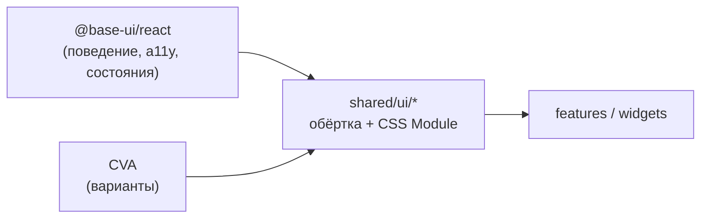

# 11. UI-кит (`shared/ui`)

## Обзор

`shared/ui` — библиотека переиспользуемых UI-компонентов без бизнес-логики. Большинство компонентов — тонкие обёртки над **unstyled-примитивами `@base-ui/react`**, установленные через реестр **roiui** (shadcn CLI) и адаптированные под структуру FSD.



## Каталог компонентов

| Компонент | Основа | Экспорт | Где используется |
|---|---|---|---|
| `button` | Base UI Button + CVA | `Button`, `buttonVariants`, `Spinner`, `ArrowPointer` | `HiddenSidebar`, `Notes` |
| `input` | Base UI Input | `Input` | `Sources` (поиск), `AddMesh` |
| `checkbox` | Base UI Checkbox | `Checkbox`, `CheckboxIndicator` | `Layers` |
| `tabs` | Base UI Tabs | `Tabs`, `TabsList`, `TabsTrigger`, `TabsContent`, `TabsIndicator` | `Sources` |
| `toolbar` | Base UI Toolbar | `Toolbar`, … | `ToolbarScene` |
| `toggle-group` | Base UI ToggleGroup | `ToggleGroup`, `ToggleGroupItem` | `ToolbarScene` |
| `toggle` | Base UI Toggle | `Toggle` | — |
| `tooltip` | Base UI Tooltip | `Tooltip`, `TooltipTrigger`, `TooltipPortal`, `TooltipPositioner`, `TooltipPopup`, `TooltipArrow` | `ToolbarScene` |
| `drawer` | Base UI Drawer | `Drawer`, `DrawerTrigger`, `DrawerPortal`, `DrawerPopup`, … | `Notes` |
| `collapsible` | Base UI Collapsible | `Collapsible`, `CollapsibleTrigger`, `CollapsiblePanel` | — (под дерево слоёв) |
| `avatar` | Base UI Avatar | `Avatar`, `AvatarImage`, `AvatarFallback` | — (под профиль) |
| `select`, `dropdown-menu`, `autocomplete`, `scroll-area` | Base UI | — | — |
| `hidden-sidebar` | **собственный** | `default HiddenSidebar` | `Sources`, `Layers` |
| `tile` | **собственный** (`next/image`) | `Tile` | `Sources` |

## Паттерн обёртки над Base UI

Все компоненты из roiui устроены одинаково:

```tsx
// shared/ui/tabs/tabs.tsx
import { Tabs } from '@base-ui/react/tabs'
import { cn } from '@lib/styles/utils'
import styles from './tabs.module.css'

function TabsRoot({ className, ...props }: Tabs.Root.Props) {
  return <Tabs.Root className={cn(className, styles.root)} {...props} data-slot="tabs-root" />
}
// ...
export { TabsRoot as Tabs, TabsContent, TabsList, TabsTrigger }
```

Ключевые соглашения:

1. **Пропсы примитива пробрасываются как есть** — тип `Tabs.Root.Props` из Base UI, без собственного API поверх.
2. **Стили — CSS Module рядом с компонентом**, внешний `className` мержится через `cn()`.
3. **`data-slot="..."`** на каждой части — стабильный селектор для стилизации и тестов, не зависящий от хешей CSS Modules.
4. **Именованные экспорты**; корневая часть экспортируется под коротким именем (`TabsRoot as Tabs`).
5. Компоненты с порталами/состоянием (`drawer`, `tooltip`) помечены `'use client'`.

### Проп `render` вместо `asChild`

Base UI позволяет подменить DOM-элемент части через `render`. Так триггеры получают вид кнопки из кита без лишней обёртки:

```tsx
<DrawerTrigger render={<Button className={styles['drawer-trigger']}>Заметки</Button>} />

<TooltipTrigger render={
  <ToggleGroupItem onClick={() => tools.setCurrent(t.id)}>
    <Image src={t.iconURL} alt={t.name} width={32} height={32} />
  </ToggleGroupItem>
} />
```

> [!TIP]
> `render` объединяет пропсы и обработчики триггера с переданным элементом — фокус, ARIA-атрибуты и состояние `data-*` остаются на итоговом DOM-узле.

## Собственные компоненты

### `HiddenSidebar`

Сворачиваемая боковая панель с заголовком и кнопкой-переключателем.

```tsx
<HiddenSidebar
  title="Ресурсы"
  orientation="left"        // 'left' | 'right' — к какому краю прижата
  positionButton="start"    // 'start' | 'center' | 'end' — где кнопка по вертикали
  maxWidth="324px"          // ширина панели и величина сдвига при сворачивании
  onChange={() => {}}       // опционально, вызывается при переключении
>
  {children}
</HiddenSidebar>
```

Как работает:

- Состояние `isView` — локальный `useState` (по умолчанию `true`).
- Сворачивание — **отрицательный `margin-left`/`margin-right` на `maxWidth`**. Панель уезжает за край, а соседний flex-элемент (сцена) занимает освободившееся место. Анимацию даёт `duration-300`: он задаёт `transition-duration`, а `transition-property` по умолчанию `all`. Класс `transition-margin-left` в Tailwind не существует и ничего не делает — корректный вариант `transition-[margin]`.
- Кнопка позиционируется абсолютно; в свёрнутом состоянии выносится за край панели (`right: -30px` / `left: -30px`), чтобы оставаться видимой, а иконка разворачивается на 180°.

> [!NOTE]
> Состояние открытости не сохраняется между перезагрузками и не доступно снаружи. Если понадобится управлять панелями из стора (например, хоткеем), компонент нужно сделать контролируемым: `isView` + `onChange(isView)`.

### `Tile`

Квадратная плитка-превью ресурса (`aspect-ratio: 1`, `max-width: 90px`) с `next/image` внутри. Принимает все `HTMLAttributes<HTMLDivElement>`; `title` используется как `alt` изображения.

## Стили кита

| Тип файла | Где | Почему |
|---|---|---|
| `*.module.css` | компоненты из roiui | Так их поставляет реестр; не требуют SASS-переменных |
| `*.module.sass` | `hidden-sidebar`, `tile` | Собственные компоненты, пишутся в стиле проекта |

Цвета берутся из CSS Custom Properties темы (`var(--card)`, `var(--foreground)` и т.д.), поэтому компоненты автоматически следуют `data-theme`. Исключение — `Tile` с захардкоженным фоном `#FDAC8A`.

## Добавление компонента из roiui

Процедура описана в [add-ui.md](./add-ui.md). Кратко:

```bash
npx shadcn@latest add @roiui/<component> -p src/shared/ui/<component>
```

После установки:

1. Заменить импорт `cn` на `import { cn } from '@lib/styles/utils'`.
2. Создать `index.ts` с `export * from './<component>'`.
3. Импортировать компонент только через баррель: `@/shared/ui/<component>`.

> [!WARNING]
> В `add-ui.md` указан путь `@lib/shadcn/utils` — такого модуля нет, актуальный путь `@lib/styles/utils`. Скрипт `npm run ui:add` ссылается на несуществующий `scripts/add-ui.ts`.

## Правила для `shared/ui`

- ❌ Не импортировать ничего из `entities`/`features`/`widgets` и не обращаться к MST-стору.
- ❌ Не использовать `export default` — он ломает `export *` в барреле (см. `HiddenSidebar`).
- ✅ Любое состояние — либо внутреннее UI-состояние (открыт/закрыт), либо через пропсы.
- ✅ Новые варианты внешнего вида — через CVA-варианты, а не через новые компоненты.
