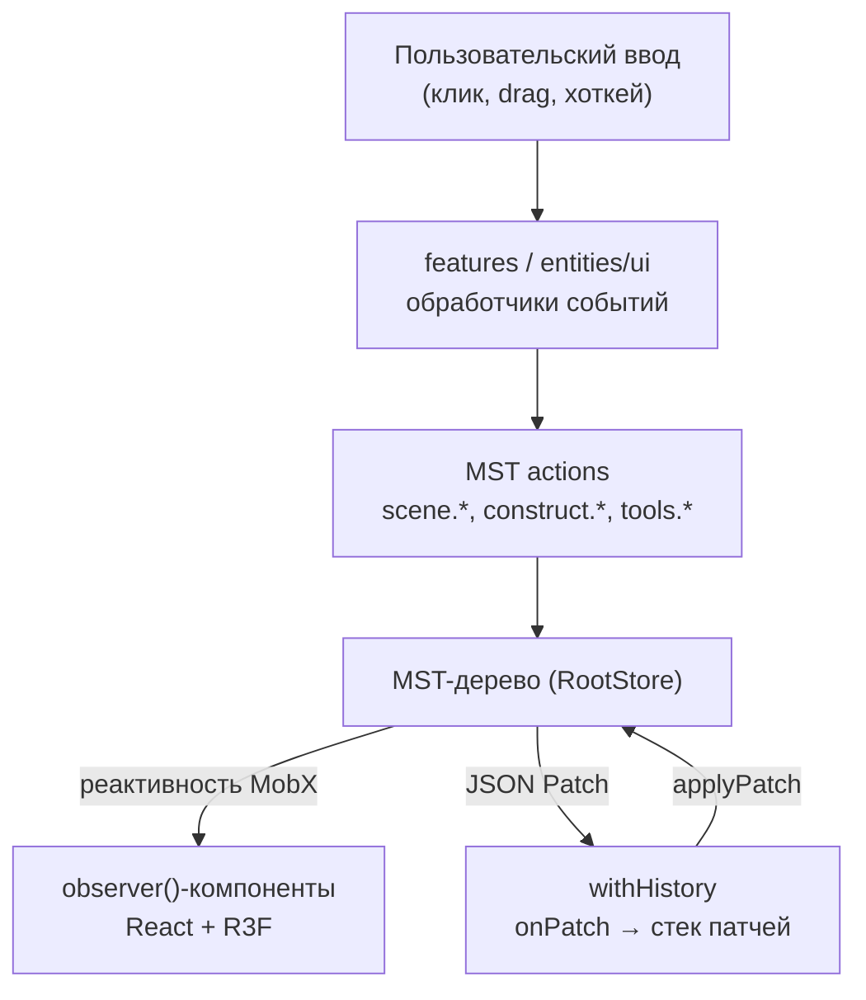
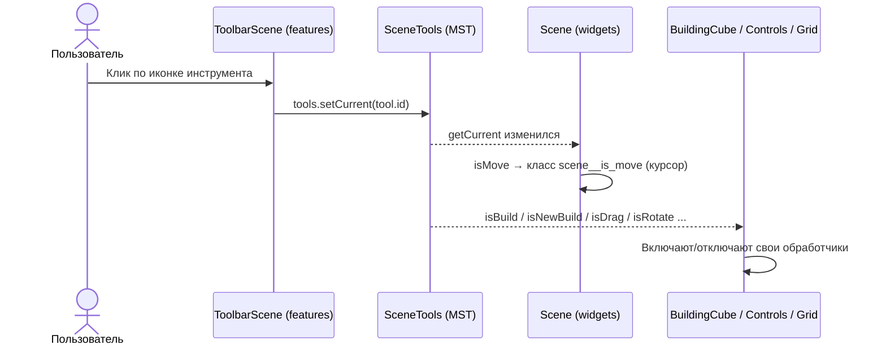
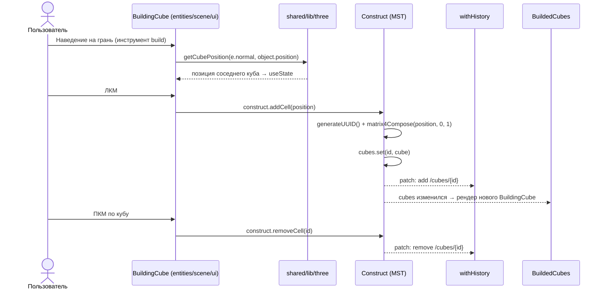
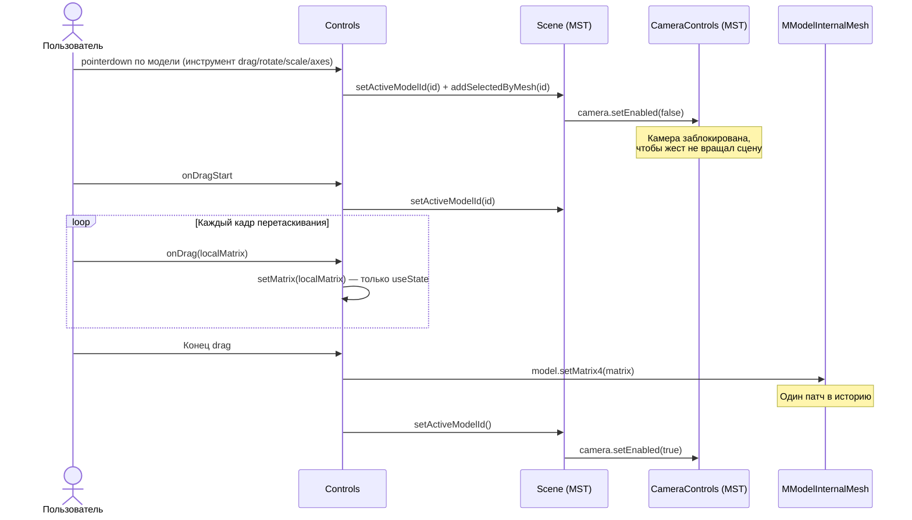
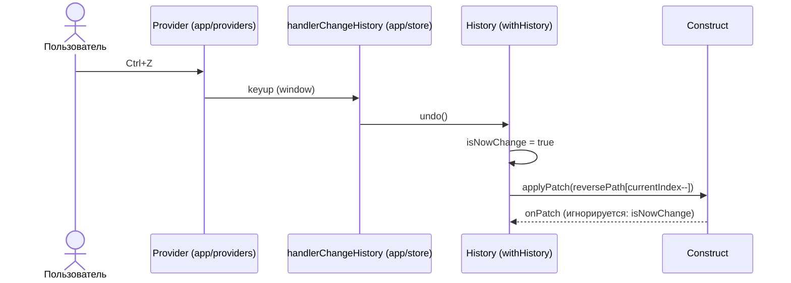
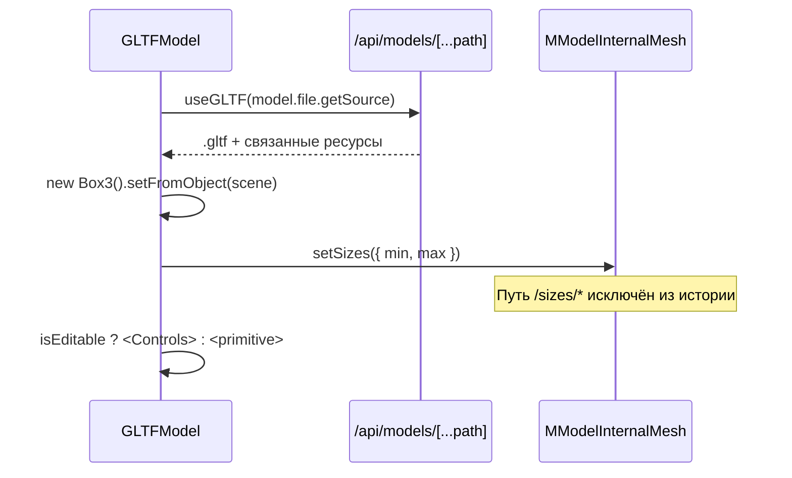

# 12. Потоки данных и пользовательские сценарии

Документ показывает, как слои и модели взаимодействуют в конкретных сценариях редактора. Статическая структура описана в [Управлении состоянием](./03-state-management.md) и [3D-движке](./04-3d-engine.md).

## Общая схема

Принципы:

- **Однонаправленный поток.** Компоненты не мутируют данные напрямую — только через actions моделей.
- **Состояние инструментов — тоже в MST.** Поведение 3D-объектов определяется флагами текущего инструмента (`tools.getCurrent`), а не пропсами.
- **Промежуточные значения — локально.** Во время перетаскивания матрица хранится в `useState` компонента и пишется в стор один раз по окончании жеста — история не засоряется сотнями патчей.

## Сценарий 1. Выбор инструмента

`Tool` — набор булевых флагов возможностей, а не enum. Один инструмент может включать несколько режимов: `transform` = `isRotate + isScale + isAxes`. Компоненты проверяют только нужные им флаги:

| Компонент | Читает флаги | Поведение |
|---|---|---|
| `Scene` (виджет) | `isMove` | Меняет курсор над канвасом |
| `InteractiveGrid` | `isNewBuild` | Показывает плоскость для размещения первого куба |
| `BuildingCubeTransparent` | `isNewBuild` | Рисует «призрак» и ставит куб по клику |
| `BuildingCube` | `isBuild` | Достраивает/удаляет кубы по клику на грань |
| `Controls` | `isDrag`, `isRotate`, `isScale`, `isAxes` | Выбирает `DragControls` или `PivotControls` для модели |

> [!TIP]
> Чтобы добавить инструмент, достаточно расширить `TypeLiteralTools`, добавить флаг в `Tool` и запись в начальный снапшот `RootStore`. Тулбар отрисует его автоматически из `tools.getTools`.

## Сценарий 2. Строительство кубов

- Позиция хранится не тремя числами, а **матрицей 4×4** (`matrix4`) — единый формат для кубов и моделей (миксин `withMatrix4`).
- `cubes` — `t.map` по ID: добавление/удаление не перерисовывает существующие кубы, `BuildedCubes` лишь добавляет/убирает дочерний компонент.

## Сценарий 3. Выделение и трансформация модели

`activeModelId` — флаг «идёт жест над моделью»; `selectedMeshIds` — постоянное выделение. Клик мимо модели (`onPointerMissed`) снимает и то и другое. `PivotControls` активен только у выделенной модели; `DragControls` (инструмент `drag`) работает без выделения. Геттер `scene.getSelectedMeshes()` ищет ID и среди кубов, и среди моделей, поэтому выделение работает для обоих типов мешей.

## Сценарий 4. Undo / Redo

Детали реализации (`shared/lib/mst/with-history.ts`):

- История подключена **только к `scene.construct`** — кубы и модели. Выбор инструмента, выделение и камера в историю не попадают.
- Пути `/sizes/min` и `/sizes/max` исключены: размеры bounding box модели вычисляются при загрузке GLTF и не являются действием пользователя.
- Патчи и обратные патчи хранятся в `volatile` — они не попадают в снапшоты стора.
- Новое действие после undo обрезает «будущее» (`splice(currentIndex + 1, Infinity, ...)`) — классическая линейная история.

> [!WARNING]
> Флаг `isNowChange` сбрасывается на первом же входящем патче. Если `applyPatch` порождает несколько патчей (например, патч на целый объект), второй и последующие запишутся в историю как новое действие. Для составных операций стоит группировать патчи по action (`onAction` / `recordPatches`).

## Сценарий 5. Загрузка GLTF-модели

Источник файла — `MUrlOrCache` (`url` + `cacheUrl`); геттер `getSource` возвращает `cacheUrl`, если он есть, иначе `url`. URL указывает на локальный `public/local_models/...` или на API-прокси Яндекс Диска. Если сцена не редактируемая (`isEditable = false`), модель рендерится без `Controls`.

## Где что живёт

| Данные | Хранилище | Почему |
|---|---|---|
| Кубы, модели, их трансформации | MST `scene.construct` | Персистентные данные сцены, нужна история |
| Текущий инструмент, выделение, сетка | MST `scene` | Читаются многими компонентами в разных слоях |
| Параметры камеры, `realTimeZoom` | MST `scene.camera` | Блокируется из стора на время жестов; не нужна в истории |
| Матрица во время drag | `useState` в `Controls` | Высокочастотные обновления, не должны попадать в стор |
| Открыта ли боковая панель | `useState` в `HiddenSidebar` | Чисто UI-состояние |
| Каталог ресурсов (будущее) | React Query + `localStorage` | Серверные данные, кэш 24 ч |
| Сессия пользователя (план) | MST `profile` → `SessionProvider` | Сейчас профиль пуст: авторизация не реализована, `setProfile` не вызывается |
